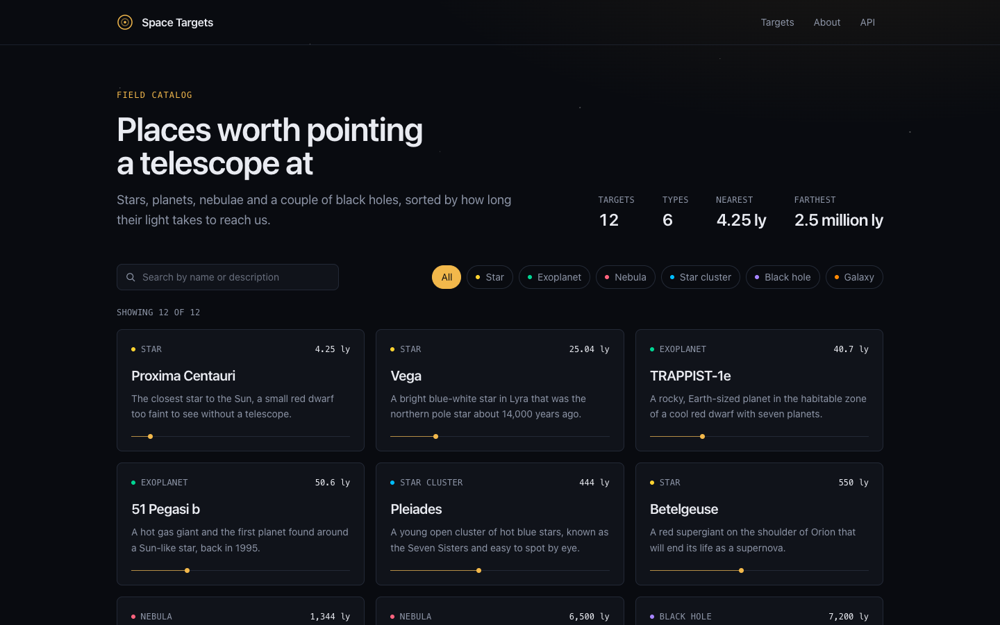

# Space Targets

A small Next.js starter. It is a catalog of places in space with search, a type filter, detail pages and a JSON API. There is no database and nothing to configure. The data lives in one TypeScript file.

Use it as a base for your own app. Replace the data, the pages and the styles as you go.

## What is inside

- Next.js 16 with the App Router and React 19
- TypeScript in strict mode
- Tailwind CSS 4
- ESLint with the Next.js rules
- A Dockerfile that builds a small standalone image

## Routes

| Route | What it does |
| --- | --- |
| `/` | The list of targets with a search box and a type filter |
| `/targets/[slug]` | The detail page for one target |
| `/about` | What the starter contains and where to edit things |
| `GET /api/targets` | All targets as JSON. Supports `?type=` and `?q=` |
| `GET /api/targets/[slug]` | One target as JSON, or a 404 |
| `GET /api/health` | Returns `{ "status": "ok" }` |

Valid values for `type` are `star`, `exoplanet`, `nebula`, `cluster`, `black-hole` and `galaxy`. An unknown type returns a 400.

```bash
curl "http://localhost:3000/api/targets?type=star&q=red"
```

## Run it locally

You need Node.js 22 or newer.

```bash
npm install
npm run dev
```

Open http://localhost:3000. No environment variables are needed.

Other scripts:

```bash
npm run lint       # ESLint
npm run typecheck  # generate route types, then tsc --noEmit
npm run build      # production build
```

## Run it with Docker

```bash
docker build -t space-targets .
docker run --rm -p 3000:3000 space-targets
```

Or with Compose:

```bash
docker compose up --build
```

## Change the data

All targets are in [`data/targets.ts`](./data/targets.ts). Add, edit or remove entries there. The home page, the detail pages and the API all read from that file.

Each target needs a unique `slug`. It becomes the URL of the detail page. To add a new type, add it to `TARGET_TYPES` in the same file and give it a dot color in `components/type-badge.tsx`.

Colors and fonts are Tailwind theme variables at the top of [`app/globals.css`](./app/globals.css).

## Deploy on Rock8Cloud

Rock8Cloud builds the `Dockerfile` in the repo root and runs the image. The app listens on port 3000. It needs no environment variables and no database.

Every push to `main` builds and deploys a new version. Check `/api/health` to see that the app is up.

## A note on TypeScript

TypeScript is pinned to 6.x because ESLint's TypeScript support does not run on 7 yet. Renovate will offer the upgrade when it does.
